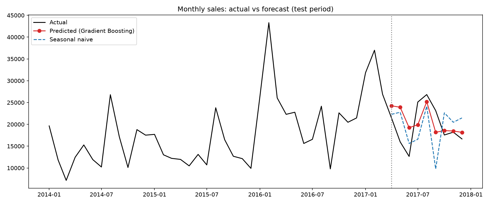

# Retail Sales Analytics & Forecasting System

End-to-end analytics project: cleaned retail sales data with Python, analyzed it in MySQL, built reporting in Excel and Power BI, and forecast monthly sales with scikit-learn.

## Business questions
1. Which categories, regions and products drive profit, and which lose money?
2. How do discounts affect profitability?
3. What are the sales trends and seasonality?
4. Can next months' sales be forecast better than a simple baseline?

## Tech stack
Python (Pandas, NumPy, Matplotlib, Seaborn, scikit-learn) · MySQL · Excel · Power BI

## Dataset
Sample Superstore sales data (<N> rows, <date range>), sourced from Kaggle. <Add the dataset's license/source link.>

## Workflow
Raw CSV → Pandas cleaning and EDA → MySQL → SQL analysis → Excel pivots and KPIs → Power BI dashboard → scikit-learn forecasting

## Key findings
- <Finding 1 with a number, e.g. "Sub-category X loses $Y despite $Z in sales">
- <Finding 2: discount band at which profit turns negative>
- <Finding 3: seasonality or growth trend>
- <Finding 4: best and worst region/category>

## Forecasting results
| Model | MAE | RMSE | MAPE |
|---|---|---|---|
| Naive (last month) | | | |
| Seasonal naive | | | |
| <Best ML model> | | | |

<Two sentences: did the ML model beat the baseline? What are the limits (about 48 months of data, no external drivers)?>

## Dashboards




## Repository structure
```
data/        raw and processed data
notebooks/   01 cleaning and EDA, 02 MySQL load, 03 forecasting
sql/         analysis queries (aggregations, window functions, CTEs)
dashboards/  Excel workbook, Power BI file, screenshots
```

## How to run
1. Clone the repo and create a virtual environment: `python -m venv venv`, then activate it
2. `pip install -r requirements.txt`
3. Install MySQL, create a database `retail_db` and a user with access
4. Copy `.env.example` to `.env` and fill in your credentials
5. Run notebooks 01 → 02 → 03 in order
6. Open the `.xlsx` in Excel and the `.pbix` in Power BI Desktop

## Limitations and next steps
- Only <N> months of data, so model results are noisy
- No external features (promotions, holidays, pricing)
- Next: add more features, try SARIMA/Prophet, refresh the dashboard automatically
